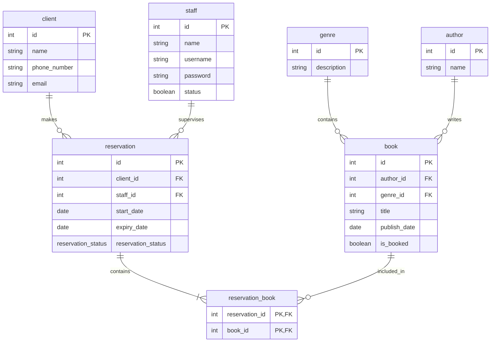

# genre
- id
- description

# author
- id
- name

# book
- id
- author_id (FK)
- genre_id (FK)
- title
- publish_date
- is_booked (boolean)

# staff
- id
- name
- username
- password
- status (boolean)

# client
- id
- name
- phone_number
- email

# reservation 
- id
- client_id (FK)
- staff_id (FK)
- start_date
- expiry_date
- reservation_status

# reservation_status ENUM
- cancelled
- pending
- fulfilled
- expired
- available

# reservation_book
- reservation_id (FK)
- book_id (FK)

